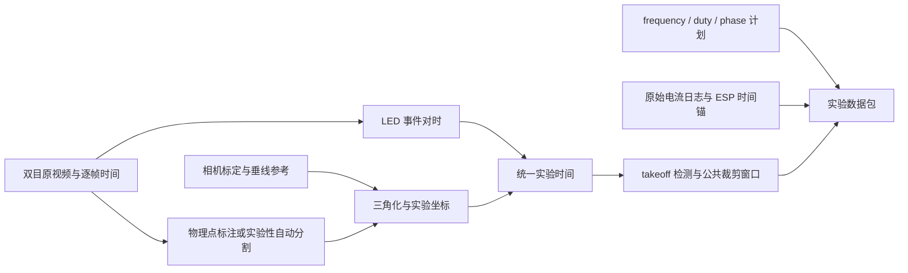

# LLM：从实验记录到可供分析的数据包

第一版把两路视频、输入 pattern、电流记录和轨迹放入同一次实验，输出统一时间轴、起飞事件、曲线和两路同步预览。现阶段在本地运行，不需要 LLM API。

**统一入口：[record_experiment.ipynb](record_experiment.ipynb)**。按配置、ChArUco 标定/复用验证、AprilTag 装置定位、试录、pattern 选择、正式实验、后处理分块运行。操作与校准复用规则见 [WORKFLOW.md](WORKFLOW.md)，pattern 库见 [patterns/README.md](patterns/README.md)。前半只用相机；正式 block 显式连接 flight，Record 后另点 START 才发送 ramp。不要在录像内手按 reset。

**仅同步联调：** notebook Block 0 选择 `MODE="sync_check"`，按 **0→1→4→6→7→8→9** 运行，跳过 2、3、5；保存白线参考、视频、pattern/CS/LED 曲线，暂不输出三维轨迹。详见 [联调步骤](WORKFLOW.md#先做同步联调暂缺-cadbearing)。

**只查驱动、不录像：** 可选 Block 7B 使用 Block 7 下拉框当前选中的 pattern 与串口，不需要相机、ROI、标定或试录。关闭其他串口使用者后将 `RUN_DRIVE_ONLY=True`，单独运行；READY 后立即启动，到时/Interrupt 尝试 stop，保留串口原始日志。按用户要求，Block 7B/8 均不按温度模型等待冷却，由操作者判断是否继续。测试结束将代码开关改回 False。日志在 `runs/drive_only/`，不能作为 Block 9 视频同步输入；LED 仍由 flight 固件点亮。

Windows 首次在 `ESP32_PMW` 运行 `uv sync --python 3.13`，然后在 VS Code/Jupyter 选择 `.venv/Scripts/python.exe`；Mac 使用 `.venv/bin/python`。不要复制旧电脑的 `.venv`，此流程不需要 `--extra native`。下面历史示例中的 `.venv/bin/python` 在 Windows 改用 `.venv\Scripts\python.exe`；多行 shell 续行符也应按本机终端调整，优先使用 notebook。

2026-10-27：Python 采集后端已分为 macOS AVFoundation / Windows DirectShow / Linux V4L2；Windows 可用 `--backend msmf` 对照测试，两相机必须统一后端，并重新核对编号。自动探测只是能读取指定尺寸的候选，不提供 Windows USB 身份保证。`--fps` 现在同时请求相机帧率与设置播放 FPS，实际速率仍按源时间测量。录像选择 `avc1` 或 `mp4v` 并记录实际编码器；两路用同一编码方式。Windows 双机实拍与帧率验收尚未完成。

**第一次上机先看 [实验操作清单](EXPERIMENT_CHECKLIST.md)**：从双相机预览、实物标定、垂锤参考，到同步联调和首个真实实验包，逐步操作并记录进度。

Flight 的 LED START、现有 runner 原始串口日志和离线自动关联见 [START_SYNC.md](START_SYNC.md)。已实现并通过离线验证，仍待烧录与台架验收。



## 先运行离线示例

以下命令在 `ESP32_PMW/` 执行，使用现有 `.venv`；不会打开相机、串口或驱动线圈。

```bash
.venv/bin/python -m LLM demo LLM/runs/my_demo
.venv/bin/python -m LLM self-check
```

已有同名实验会拒绝覆盖。Demo 创建 240 帧双目合成视频、两次 LED 脉冲、已知物理点投影、frequency pattern 和合成电流，再实际解码视频、对时、三角化、检测起飞、画图、编码预览。

查看 `LLM/runs/my_demo/export/report.md` 和 `overview.png`。合成例子的像素对应由真值生成，**不能证明真实 robot 自动识别或硬件同步精度**。每份包均标记 source=synthetic 或 real。

## 已经可以做什么

| 环节 | 当前实现 | 实验边界 |
|---|---|---|
| 双相机录制 | 复用 `controller.camera.record`，保存原始逐帧时间、掉帧标志 | 软件配对，不是硬件同步曝光 |
| 相机标定 | 复用 `controller.calib.calibrate`；每个 run 保存快照 | 必须匹配相机顺序、分辨率、旋转和裁剪 |
| 实验坐标 | 垂线 + bearing + 投影后的 camera A 右方向 | 整体移动后验证双目参数并重建装置参考 |
| LED 对时 | ROI 亮度、迟滞、连续帧确认，保留事件区间 | 单次脉冲只估 offset；两次可估平均时钟比例 |
| XYZ 与轴方向 | 双目物理点对应三角化；位置与方向独立质量门限 | 轴端点必须可见且是同一物理点 |
| 自动 CV | 复用现有 disc 分割，逐帧导出 ellipse center | 实验性位置代理；不输出有效的轴方向 |
| 电流 | 解析现有四路低频 CS telemetry；保留原始日志 | 不是有符号波形、基波幅值、RMS 或实测 phase |
| 输入 pattern | common frequency ramp + 四路 duty/phase 更新 | 当前保存和绘制计划，不执行任意 schedule |
| takeoff | 高度阈值 + 向上趋势 + 持续时间 + 缺口检查 | 是中心高度代理；须用真实 bearing 脱离视频验证 |
| 导出 | 曲线、CSV、quality、哈希、两路共同时间网格预览 | 原始视频与帧映射仍是分析依据 |

详细字段见 [SCHEMA.md](SCHEMA.md)，上机待办见 [STATUS.md](STATUS.md)。

## 一次真实实验的使用流程

### 1. 固定相机，标定并记录实验条件

使用已有标定入口，不另写一套相机模型：

```bash
.venv/bin/python -m controller.calib.calibrate --help
```

实际采集时用不同位置/倾角的标定板，量实打印尺寸；输出包含两相机 K、dist、外参、image_size 和误差报告。标定的 camera A 坐标不是重力坐标。现存 `controller/calib/stereo_rig.json` 为 640×400，不能直接用于 1280×800 原视频。

```bash
.venv/bin/python -m LLM init LLM/runs/run_001
.venv/bin/python -m LLM example-pattern LLM/runs/run_001/pattern.json
```

填写 `manifest.json` 的 robot_id、coil_setup_id、bearing_id、notes，修改 pattern 为实际打算使用的输入。示例中的数字只是格式示范，未作为可飞配方验证。

### 2. 录制并导入双视频

```bash
.venv/bin/python -m LLM record results/flights --indices 0 1 --width 640 --height 400
.venv/bin/python -m LLM import-flight LLM/runs/run_001 results/flights/你的录制目录
```

SPACE 开始/停止录制，q 结束。默认图像翻转 180°，与已有 recorder 一致；不需翻转时用 `--no-flip`，且标定必须使用相同处理。录制只占用相机。原有 flight controller 如果已占用相机，直接导入它产生的 FlightWriter 录像，不同时打开第二个 recorder。

导入会核对两路实际解码帧数、`written` 标志、严格递增的源时间及元数据。它不会把掉帧后的第 i 帧错误地配给原 CSV 第 i 行。

### 3. 建立重力坐标

在一对静止双目帧中分别标出同一个 bearing 参考点、垂线顶端、垂线底端，保存下面格式的 JSON。数字必须换成真实图像像素，`frame_index` 是原录制编号：

```json
{
  "schema_version": 1,
  "frame_index": 0,
  "bearing": {"a": [320, 200], "b": [260, 200]},
  "plumb_top": {"a": [340, 100], "b": [280, 100]},
  "plumb_bottom": {"a": [340, 180], "b": [280, 180]},
  "x_hint_camera": [1, 0, 0],
  "note": "填写原始帧和固定标记说明；以上像素仅为格式示例"
}
```

```bash
.venv/bin/python -m LLM world-from-points LLM/runs/run_001 --reference world_reference.json --calibration controller/calib/stereo_rig.json --confirm-preprocessing
```

`--confirm-preprocessing` 仅在旧标定缺少旋转元数据、且你实际确认 A/B 顺序、旋转、裁剪一致后使用；它不会修正不匹配。新标定有完整匹配元数据时不需要这个参数。

程序自动三角化三点：origin=bearing，z=bottom→top，x=相机 A +x 在垂直 z 平面内的投影，y=z×x。桌面是否水平不影响数学正交性。相机 A 的 +x 是图像坐标向右对应的三维相机轴，不是桌子的方向。

如果已有测好的 camera A 三维 origin/up，可用 `LLM world --origin ... --up ... --evidence ...`。不要把示例值当作实验测量。

### 4. 关联 LED 和 ESP 时间

录像应在 LED 暗时开始，拍到明确的 START 亮起。确定 LED 的像素 ROI 后：

```bash
.venv/bin/python -m LLM sync LLM/runs/run_001 --roi-a 20 20 24 24 --roi-b 40 30 24 24 --pulse-times 0
```

这里 ROI 也是示例。若有两个可对应的脉冲，例如实验时间 0 s、10 s，用 `--pulse-times 0 10`。检测数必须与事件数一致，不猜哪个闪烁是 START。查看 `processed/led_A.csv`、`led_B.csv`、`sync.json` 的区间与原视频。

更新后的 `flight` 固件在 IDLE 保持 LED 灭，接受 `seq=go` 时记录 LED/首次驱动调用时间。配合 Python runner 的 `sync_start=True` 与 `telemetry_path` 后，使用下面命令自动关联三路时钟（ROI 数字仍是示例）：

```bash
.venv/bin/python -m LLM sync-start LLM/runs/run_001 --roi-a 20 20 24 24 --roi-b 40 30 24 24
```

该路径不需要另行执行 `clock`，会验证唯一 READY/START 并保存日志哈希。详见 [START_SYNC.md](START_SYNC.md)。旧固件、tilt 的开机/步骤指示不能当作这个 START；新固件尚需上机验证，软件时间不等于实测电流起始。

电流的 ESP `t=` 是设备毫秒时钟。只有获得同一事件在设备时钟和实验时钟中的对应关系，才添加映射，例如：

```bash
.venv/bin/python -m LLM clock LLM/runs/run_001 --source-times 12.345 --experiment-times 0 --evidence "填写实测 START 事件记录及设备时间来源"
```

12.345 仅展示秒单位。没有可靠对应关系就不填写；电流会保留为 unsynchronized，报告不会把它画到已对齐的时间轴上。LED 的光学起始、驱动指令应用、电流实际起始之间的延迟应保留和测量。

重新运行 sync 会清除旧 ESP 映射，因为实验零点/脉冲对应可能已经改变；之后需要重新提供 clock 的实测对应。

### 5. 导入/采集电流与实际执行记录

把 serial 原始数据保存为 `raw/telemetry.jsonl`，每行包含 `host_receive_s` 和原始 `line`，见 SCHEMA。正在运行的 controller 应从它自己的唯一串口读取处复制日志，不能再开一个接收者抢串口。

只有当该串口没有被 controller 使用时，才可用本模块的被动接收入口：

```bash
.venv/bin/python -m LLM record-telemetry LLM/runs/run_001/raw/telemetry.jsonl --port /dev/cu.你的设备 --seconds 30
```

这个入口不发送指令、不调用 reset；不会替代驱动程序的 thermal 记账。适配器打开串口是否影响具体板卡仍须上机确认。Python flight runner 已通过 `telemetry_path` 接入唯一 reader 的日志 tee；独立 native runner 尚未接入。

未来固件提供完整执行快照后，可放入 `raw/applied_commands.csv`；当前不要用 planned 或 host-send 时间伪装成 device-applied。

### 6. 提取轨迹和姿态

可检查的基准路径是同一物理点与轴端点的对应像素 CSV，格式见 SCHEMA：

```bash
.venv/bin/python -m LLM pose LLM/runs/run_001 --annotations annotations.csv --calibration controller/calib/stereo_rig.json --confirm-preprocessing
```

缺失标注不插值；轴端点缺失只让 orientation 无效，不丢掉已可靠重建的位置。当前没有交互式逐点标注 UI，CSV 可由人工或另一个 detector 生成。

也可试现有自动分割：

```bash
.venv/bin/python -m LLM auto-pose LLM/runs/run_001 --calibration controller/calib/stereo_rig.json --confirm-preprocessing
```

它把 ellipse center 当作位置候选，尚未证明这个点在两视图中代表同一物理点；输出明确带 `experimental_ellipse_center_proxy`。水平方向拍摄时细轴/盘面可见性需要实拍验证。这一路不会生成有效的两个姿态角。可在 config.json 的 `auto_pose` 对象调整 min_area_px、max_area_px、threshold 等算法门限；这些不是已标定的精度参数。

### 7. 检测起飞并导出

在 config.json 选择真实“仍在 bearing 上”的 baseline 区间，最好覆盖旋转中的位置噪声；默认 0–0.2 s 只是起点。确认 min_height_mm、sustain_s、max_gap_s 等门限适合这次帧率和误差。

```bash
.venv/bin/python -m LLM process LLM/runs/run_001
```

检测成功后两视频、轨迹和 curves 使用同一个 `onset−pre_roll` 到 `onset+post_takeoff` 窗口，并受两相机共同可用范围限制。实验 t=0 始终是 LED；额外提供 `t_from_takeoff_s`。没有可靠起飞时保留完整共同时间段和 no_takeoff/uncertain，不硬切一个起飞点。

`export/INCOMPLETE.txt` 表示此次处理未完成，不能当完整数据包使用。修正输入后重新运行相关步骤和 process。sync、pose 会检查输入哈希，避免换了标定/视频却使用旧结果。

交给师兄的是**整个 run 文件夹**，包含原视频、标定、pattern、源日志、processed 和 export；LLM 的视频分析部分可从这个稳定接口继续接。
